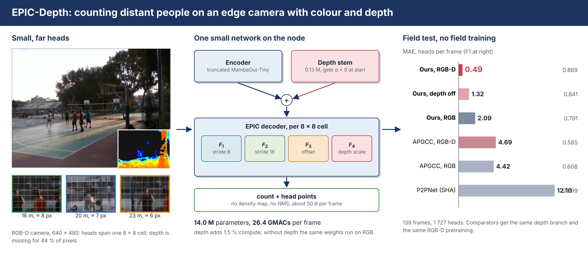
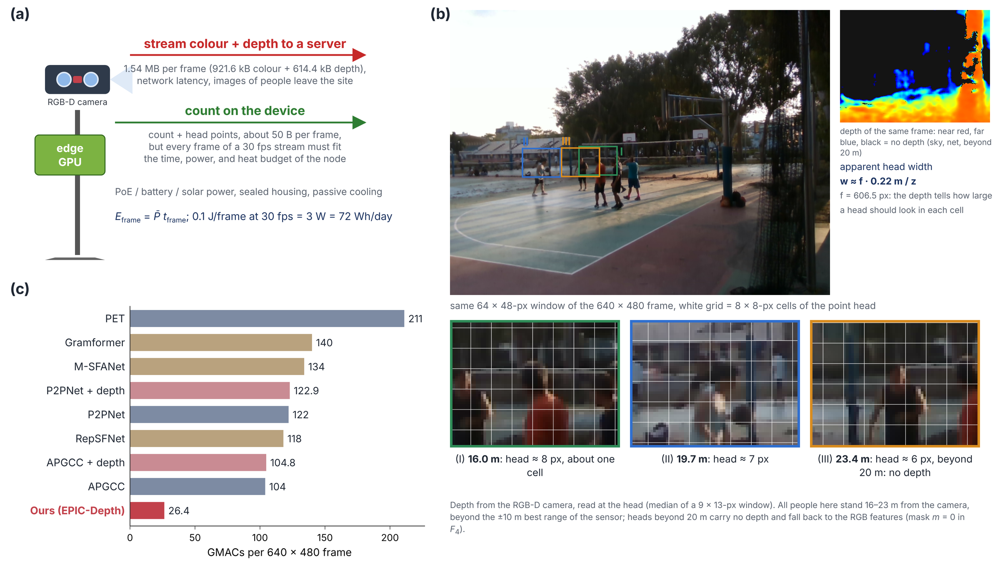
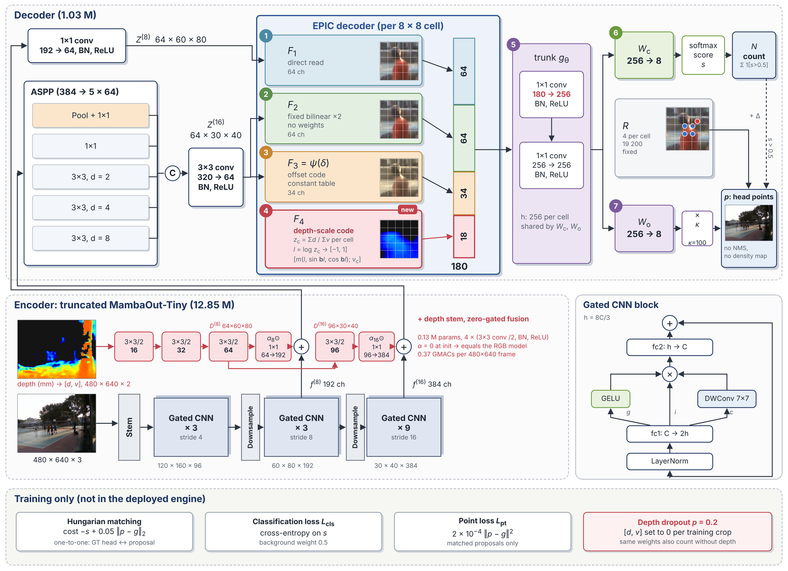
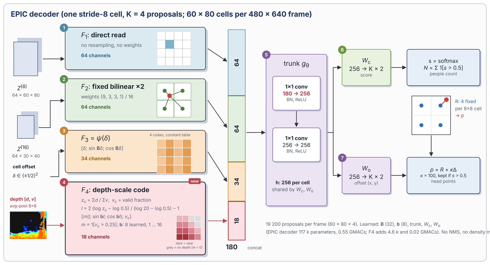
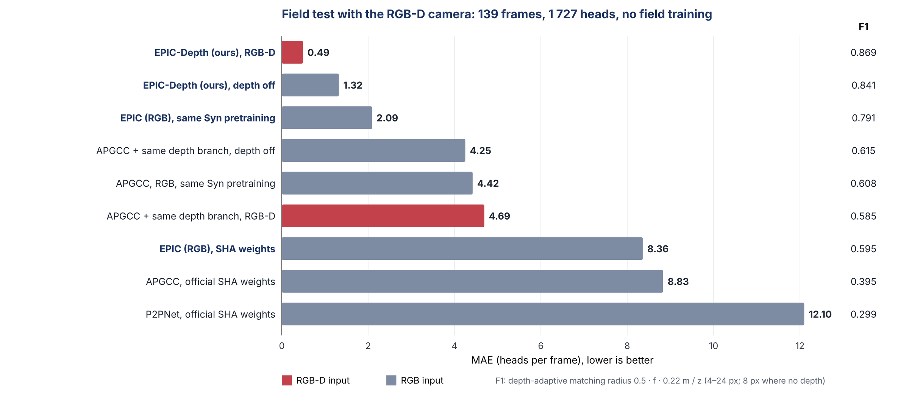
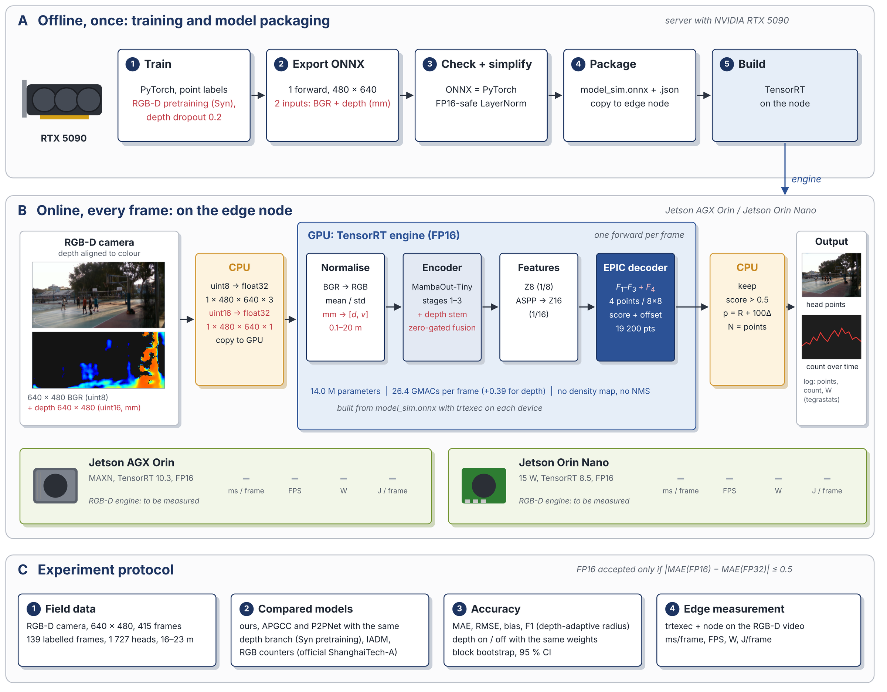

<div align="center">

# EPIC-Depth

### Efficient Point Interpolation for Counting People in RGB-D Video on Edge Camera Sensors

**Mas Nurul Achmadiah · Chi-Chia Sun · Wen-Kai Kuo · Mao-Hsiu Hsu · Jun-Wei Hsieh**

<sub>National Formosa University · National Taiwan University of Science and Technology · National Yang Ming Chiao Tung University</sub>

[](#citation)
[](#installation)
[](#installation)
[](#deploy-on-a-jetson)
[](LICENSE)

**A point-based people counter for an RGB-D camera node. On a real RGB-D field recording with people 16–23 m away, EPIC-Depth counts with MAE 0.49 (F1 0.869) at 14.0 M parameters and 26.4 GMACs per 640×480 frame. Only the count and the head points leave the device.**

</div>

<p align="center"></p>

---

## Contents

[Why on the device?](#why-count-on-the-device) · [Method](#method) · [Results](#results) · [Installation](#installation) · [Training](#training) · [Field test](#field-test-on-your-rgb-d-recording) · [Deploy](#deploy-on-a-jetson) · [Repository map](#repository-map) · [Citation](#citation)

## Why count on the device?

Streaming colour and depth to a server costs about 1.5 MB per 640×480 frame and moves images of people off-site. Counting on the camera node sends about 50 bytes per frame, but every frame must then fit the time, power and heat budget of a small edge GPU. Far heads are the hard case: at 16–23 m a head is 6–8 px wide, about one 8×8 cell of the point head.

<p align="center"></p>

Depth tells how large a head should look at each cell: `w ≈ f · 0.22 m / z`. EPIC-Depth gives the point head this cue directly, at 1.5 % extra compute.

## Method

<p align="center"></p>

| Part | What it does | Cost (640×480) |
|---|---|---|
| **Truncated MambaOut-Tiny** | Gated-CNN stages 1–3 (strides 4/8/16) on the colour image | 12.85 M |
| **Depth stem + zero-gated fusion** *(new)* | `[d, v]` → 4 × (3×3 conv /2, BN, ReLU), 16-32-64-96 ch; `f⁽⁸⁾ += α₈·P₈(D⁽⁸⁾)`, `f⁽¹⁶⁾ += α₁₆·P₁₆(D⁽¹⁶⁾)`, α = 0 at start | 0.129 M · 0.37 GMACs |
| **EPIC decoder** | per 8×8 cell: F₁ direct stride-8 read, F₂ fixed bilinear ×2 of stride 16, F₃ constant offset code, **F₄ depth-scale code** *(new)* → shared 1×1 trunk 180→256→256 | 0.55 GMACs (F₄: +0.02) |
| **Depth dropout** *(training)* | `[d, v] = 0` for 20 % of the crops: the same weights count without depth | – |
| **Output** | 4 reference points per cell, count = #(score > 0.5) | no NMS, no density map |

**F₄ (18 dims):** per cell `z_c = Σd/Σv`, `l` = log-depth over 0.5–20 m mapped to [−1, 1], `F₄ = [m·(l, sin bl, cos bl); v_c]` with `m = 1[v_c > 0.25]` and 8 frequencies `b`. Cells without depth fall back to the RGB features (`m = 0`).

Every new part starts as an exact identity (α = 0, zero trunk columns), so training starts from the RGB model. In code, EPIC is still called **EPFI** (`DECODER: EPFI`, `EPFI+dz`; `ENCODER: mambaout_tiny+dmid`): *EPIC was named EPFI in earlier versions.*

<p align="center"></p>

## Results

### RGB-D field test (main result)

- **Data:** 139 labelled frames (1,727 heads, 12.4 per frame) from an RGB-D camera, 640×480, depth aligned to colour; people stand 16–23 m away, 44 % of the pixels have no depth. No field training.
- **Protocol:** every RGB-D model is pre-trained the same way on ShanghaiTechRGBDSyn (40 epochs, LR drop at 30, seed 1229, checkpoint chosen on a hold-out by the EMA window mean). APGCC and P2PNet get **the same depth stem, fusion and depth dropout** as EPIC-Depth; F₄ is part of the EPIC decoder and is not added to them. IADM runs with its official code and RGB-D weights.
- **F1:** one-to-one matching, radius `0.5 · f · 0.22 m / z` clipped to 4–24 px (8 px where the head has no depth).

<p align="center"></p>

| Model | Input | MAE | RMSE | Bias | F1 |
|---|---|---|---|---|---|
| **EPIC-Depth (ours)** | RGB-D | **0.49** | **1.11** | +0.12 | **0.869** |
| EPIC-Depth, depth off | RGB | 1.32 | 1.94 | +0.14 | 0.841 |
| EPIC (RGB), same pre-training | RGB | 2.09 | 2.90 | −0.76 | 0.791 |
| APGCC + depth branch, depth off | RGB | 4.26 | 5.95 | −0.96 | 0.615 |
| APGCC (RGB), same pre-training | RGB | 4.43 | 6.07 | −3.11 | 0.608 |
| APGCC + depth branch | RGB-D | 4.69 | 6.32 | −2.48 | 0.585 |
| P2PNet + depth branch | RGB-D | 6.68 | 10.09 | +5.21 | – |
| P2PNet + depth branch, depth off | RGB | 6.92 | 10.64 | +5.17 | – |
| EPIC (ShanghaiTech A weights) | RGB | 8.35 | 11.54 | +6.94 | 0.595 |
| APGCC (official weights) | RGB | 8.83 | 13.62 | +6.64 | 0.395 |
| IADM (official code and weights) | RGB-D | 11.76 | 14.49 | −11.72 | density |
| P2PNet (official weights) | RGB | 12.10 | 18.47 | +9.19 | 0.299 |

<sub>Block bootstrap (blocks of 10 labelled frames, 10,000 samples): EPIC-Depth is better than every other model; vs. its own depth-off mode −0.83 [−1.04, −0.63], vs. EPIC (RGB) −1.60 [−1.89, −1.31], vs. APGCC + depth branch −4.20 [−4.96, −3.39]. Same numbers on GPU and CPU. Full tables: `results/rgbd/`.</sub>

**Reading.** Depth lowers the MAE of EPIC-Depth from 1.32 to 0.49 with the same weights. The same depth branch hardly changes APGCC (4.69 vs. 4.26 without depth) or P2PNet (6.68 vs. 6.92): the gain comes from how the EPIC decoder uses depth (F₄), not from an extra input channel.

### Edge efficiency (RGB-D engines)

One 480×640 forward per frame, raw BGR + raw depth (mm) in, normalisation on the GPU, TensorRT engines. The 139 labelled frames are played for 1 minute after 20 s of idle power; power is module power from `tegrastats`; `ms/frame` includes the CPU-side depth preprocessing.

| Model | Params | GMACs | AGX Orin FP16 ms/frame | FPS | W | J/frame | ΔMAE₁₆ |
|---|---|---|---|---|---|---|---|
| **EPIC-Depth** | **14.00 M** | **26.4** | *being measured* | | | | |
| APGCC + depth branch | 17.91 M | 104.8 | 15.32 | 65.3 | 25.8 | 0.395 | **+3.15 (FP16 not valid)** |
| P2PNet + depth branch | 18.90 M | 122.9 | 14.32 | 69.8 | 25.8 | 0.369 | +0.03 |
| IADM | 18.13 M | 155.7 | 29.90 | 33.4 | 32.0 | 0.956 | *pending* |

<sub>Orin Nano (15 W, TensorRT 8.5) and the accuracy-vs-energy figure: being measured; `deploy/rgbd_table5.py` builds both from the run folders. The FP32 engines (no TF32) reproduce the server MAE exactly (APGCC + depth 4.691, P2PNet + depth 6.705).</sub>

### Without depth (RGB camera, earlier field videos V1–V4)

The RGB results of EPIC (ShanghaiTech weights, 84 labelled frames from four videos) are kept in `results/rgb/` and `assets/charts/`. On these videos depth is not available, so EPIC-Depth runs in its depth-off mode.

<details>
<summary><b>RGB results: accuracy vs. energy on both Jetsons</b></summary>

<picture>
  <source media="(prefers-color-scheme: dark)" srcset="assets/charts/accuracy_vs_energy_dark.png">
  
</picture>

<picture>
  <source media="(prefers-color-scheme: dark)" srcset="assets/charts/field_accuracy_dark.png">
  
</picture>

Charts are generated from `results/rgb/paper_results.json` by `python tools/make_readme_figures.py`.
</details>

## Installation

EPIC-Depth is a set of **runtime plug-ins for the official [APGCC](https://github.com/AaronCIH/APGCC) code**: no APGCC file is edited.

```bash
git clone https://github.com/AaronCIH/APGCC.git
git clone https://github.com/<your-account>/EPIC-Depth.git
conda create -n epic python=3.10 -y && conda activate epic
pip install -r EPIC-Depth/requirements.txt          # + torch matching your CUDA

cd APGCC/apgcc
cp ../../EPIC-Depth/{epic,epic_depth,data_tools}/*.py .
cp ../../EPIC-Depth/deploy/*.py ../../EPIC-Depth/scripts/*.sh .
cp -r ../../EPIC-Depth/baselines .
cp ../../EPIC-Depth/configs/*.yml configs/
python apgcc_fix_train.py                           # one-time: the public APGCC release is inference-only
python smoke_test_rgbd.py -c configs/SHHB_motiny_epfi_c512_t512_ho20_ema.yml   # identity at start, depth dropout, export wrapper
python check_vgg_rgbd.py -c configs/SHHA_apg_B_0929.yml --weights weights/SHHA_best.pth   # same checks, APGCC / P2PNet depth branch
```

`epfid_deploy.py` imports `mambaout_nchw.py` (the NCHW rewrite of the MambaOut encoder used for the RGB engines); place it in the same folder.

## Training

```bash
# 1) ShanghaiTechRGBDSyn -> point lists + 16-bit depth PNGs (mm) + scene-level hold-out
python prep_shtrgbd_syn.py --src datasets/ShanghaiTechRGBDSyn --out datasets/PointDataRGBDSyn_s050 --scan
python prep_shtrgbd_syn.py --src datasets/ShanghaiTechRGBDSyn --out datasets/PointDataRGBDSyn_s050 --scale 0.5 --workers 8

# 2) the runs of the paper (same data, schedule and selection for every model)
SYN="OUT=datasets/PointDataRGBDSyn_s050 HO=ho10 TAG=SYN40 DSNAME=SHTRGBDSYN EPOCHS=40 LR_DROP=30"
env $SYN bash run_rgbd_B_1024.sh cfg
env $SYN bash run_rgbd_B_1024.sh train full     # EPIC-Depth
env $SYN bash run_rgbd_B_1024.sh train rgb      # EPIC (RGB), the depth comparison
env $SYN bash run_rgbd_B_1024.sh train apgcc    # APGCC (RGB)
env $SYN bash run_rgbd_B_1024.sh train apgccd   # APGCC + the same depth branch
env $SYN bash run_rgbd_B_1024.sh train p2pd     # P2PNet-style head + the same depth branch
env $SYN bash run_rgbd_B_1024.sh profile        # params / GMACs per part
```

EPIC-Depth starts from the UCF-QNRF EPIC weights (`INIT=` in the runbook); APGCC + depth starts from the official APGCC ShanghaiTech A weights. Watch the log for `depth dropped in x/y crops` (about 20 %) and the EMA window MAE used for selection. Syn test results are not used.

## Field test on your RGB-D recording

```bash
# colour + depth aligned to colour (ShanghaiTechRGBD style: IMG_xxxx.png + DEPTH_xxxx.mat in mm, -999 invalid)
python prep_realsense_mat.py --img-dir rec/train_img --depth-dir rec/train_depth --out field_pairs/rs_test --name rs_test
python field_annotate.py label --dir field_pairs/rs_test_gt/frames   # click heads -> <stem>.txt next to each frame

# all models side by side (models_example.json: EPIC-Depth, depth off, comparators, IADM, ONNX graphs)
python rgbd_video_test.py --source field_pairs/rs_test_gt --models models_rgbd.json --out runs/rs_test --save-points
python vis_pred_gt.py --frames field_pairs/rs_test_gt/frames --depth field_pairs/rs_test_gt/depth \
    --pred "EPIC-Depth=runs/rs_test/points/EPFI-Count-D_(ours)" "RGB=runs/rs_test/points/EPFI-Count_(RGB)" \
    --fx 606.5 --out runs/rs_test/compare
python rs_block_bootstrap.py runs/rs_test/per_frame.csv --ref "EPFI-Count-D (ours)" --block 10 --n 10000
python make_fig_assets.py --frames field_pairs/rs_test_gt/frames --depth field_pairs/rs_test_gt/depth \
    --pred "EPIC-Depth=runs/rs_test/points/EPFI-Count-D_(ours)" --out runs/rs_test/figs   # TP / FP / FN 
```

`rgbd_video_test.py` also reads RealSense `.bag`, ZED `.svo2`, and colour video + 16-bit depth.

## Deploy on a Jetson

<p align="center"></p>

```bash
# server: one 480x640 graph, raw BGR + raw depth (mm) in, opset 16, checked against PyTorch on real frames
env $SYN bash run_rgbd_B_1024.sh export full      # EPIC-Depth: NCHW rewrite + FP16-safe LayerNorm (epfid_deploy.py)
env $SYN bash run_rgbd_B_1024.sh export apgccd    # VGG comparators: no rewrite
python baselines/rgbd_baselines.py export --method iadm --repo ext/RGBTCrowdCounting \
    --ckpt ext/ckpt/iadm_rgbd_best.pth.tar --hw 480 640 --raw --opset 16 --out deploy/iadm_rgbd_480x640.onnx

# Jetson (folder with rgbd_node.py, rgbd_depth_utils.py, field_node_v*.py, rgbd_deploy/, rs_test_gt/)
sudo nvpmodel -m 0 && sudo jetson_clocks          # AGX Orin MAXN; Orin Nano: the 15 W mode
bash run_jetson_rgbd.sh agx                       # FP16 + FP32 engines, trtexec, 1-min node runs, depth off
python rgbd_table5.py --runs runs_jetson/* --trt-dir rgbd_deploy --out runs_jetson/table5   # table + accuracy-vs-energy figure
```

`rgbd_node.py` runs point counters and density counters (IADM) with the same power monitor and TensorRT runner as the RGB node (`field_node_v7.py` or later). It needs only NumPy, OpenCV and the JetPack `tensorrt` module. Live sources: `--source realsense` (depth computed on the camera) and `--source zed` (stereo depth computed on the Jetson GPU: report that run as "camera + counter").

## Pretrained weights

| Model | Training data | Field MAE (RGB-D) | Download |
|---|---|---|---|
| EPIC-Depth | UCF-QNRF → ShanghaiTechRGBDSyn | 0.49 | *GitHub Release (with the paper)* |
| EPIC (RGB) | UCF-QNRF → ShanghaiTech A / B | 8.35 (A) | *GitHub Release* |
| ONNX graphs, 480×640, raw inputs | – | – | *GitHub Release* |

## Repository map

```
EPIC-Depth/
├── epic/            RGB model + training plug-ins for APGCC (EPIC decoder = apgcc_epfi.py, MambaOut encoder)
├── epic_depth/      ★ RGB-D: depth stem, zero-gated fusion, F4, depth dropout (apgcc_rgbd.py),
│                    training launcher, one-time test with ledger, profiling, field test, matching, bootstrap
├── data_tools/      ShanghaiTech / QNRF / ShanghaiTechRGBD(Syn) conversion, RGB-D camera recordings, annotation
├── deploy/          ONNX export (RGB, RGB-D), NCHW deploy hook, TensorRT tools, Jetson node programs, Table V builder
├── baselines/       IADM / CSCA with their official code: evaluation, cost, raw-input ONNX
├── scripts/         the runbooks behind the paper's tables
├── configs/         yml configs (APGCC format); RGB-D ymls are written by run_rgbd_B_1024.sh cfg
├── tools/           block bootstrap, K-cell statistics, README charts
├── results/rgbd/    RGB-D field results, bootstrap, params / GMACs, Jetson runs
├── results/rgb/     RGB results (field videos V1–V4, ShanghaiTech ledger)
└── assets/          figures and charts
```

## Limitations

- One RGB-D recording (one scene, one camera) with one annotator; labelled frames are 3 frames apart, so a block bootstrap is used.
- People stand 16–23 m away, beyond the best range of the depth sensor: 44 % of the pixels and the heads beyond 20 m have no depth, and fall back to the RGB features.
- On TensorRT 8.5 (Orin Nano) the MambaOut encoder is slower than VGG; see `results/rgb/`.
- Energy is counter-only (depth read from disk); the depth camera's own power is not included.

## Citation

```bibtex
@article{achmadiah2026epicdepth,
  title   = {EPIC-Depth: Efficient Point Interpolation for Counting People in RGB-D Video
             on Edge Camera Sensors},
  author  = {Achmadiah, Mas Nurul and Sun, Chi-Chia and Kuo, Wen-Kai and Hsu, Mao-Hsiu and Hsieh, Jun-Wei},
  journal = {IEEE Sensors Journal},
  note    = {under review},
  year    = {2026}
}
```

## Acknowledgements

Built on [APGCC](https://github.com/AaronCIH/APGCC) (MIT), [P2PNet](https://github.com/TencentYoutuResearch/CrowdCounting-P2PNet), [MambaOut](https://github.com/yuweihao/MambaOut) and [timm](https://github.com/huggingface/pytorch-image-models). RGB-D data: ShanghaiTechRGBDSyn (pre-training). Comparators were run from the official code and weights of IADM, P2PNet, APGCC, PET, Gramformer, M-SFANet and RepSFNet.

## License

Code: [MIT](LICENSE). Field recordings are not distributed (they show identifiable people); annotations-derived tables and per-frame results are in `results/`.
