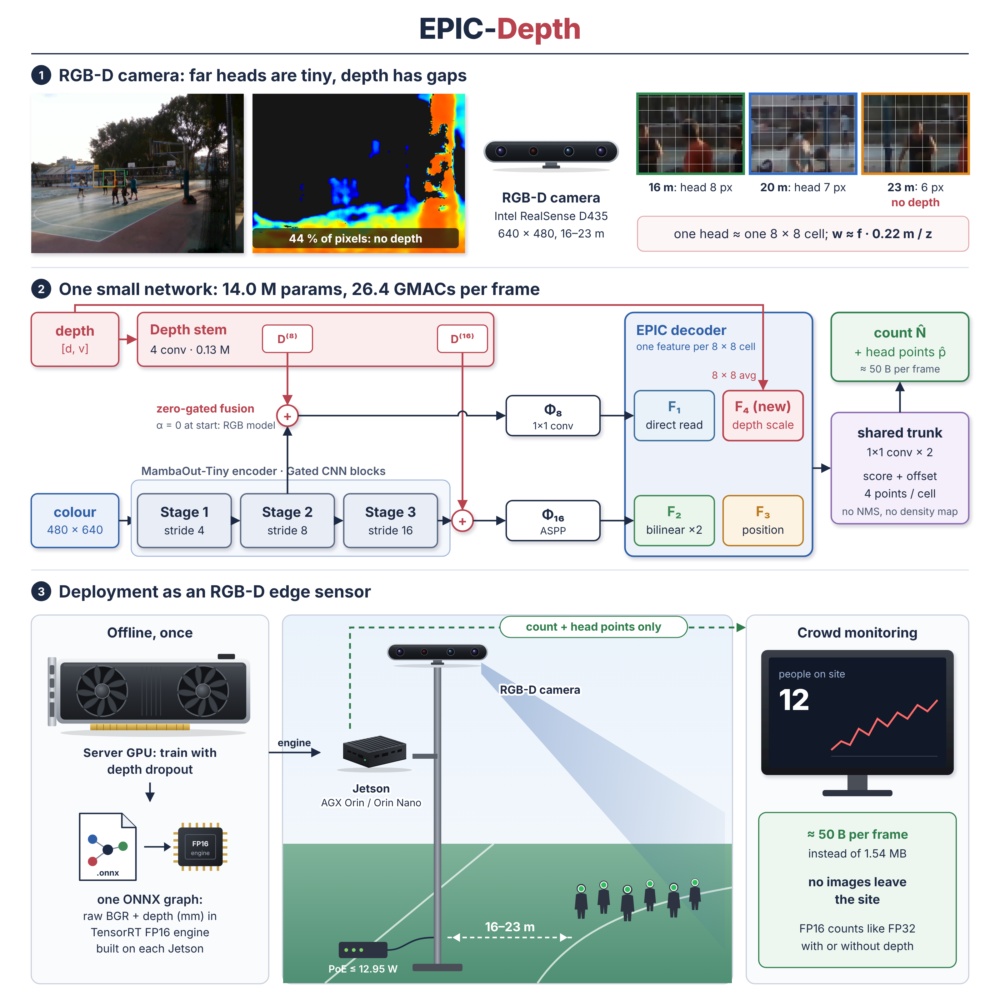
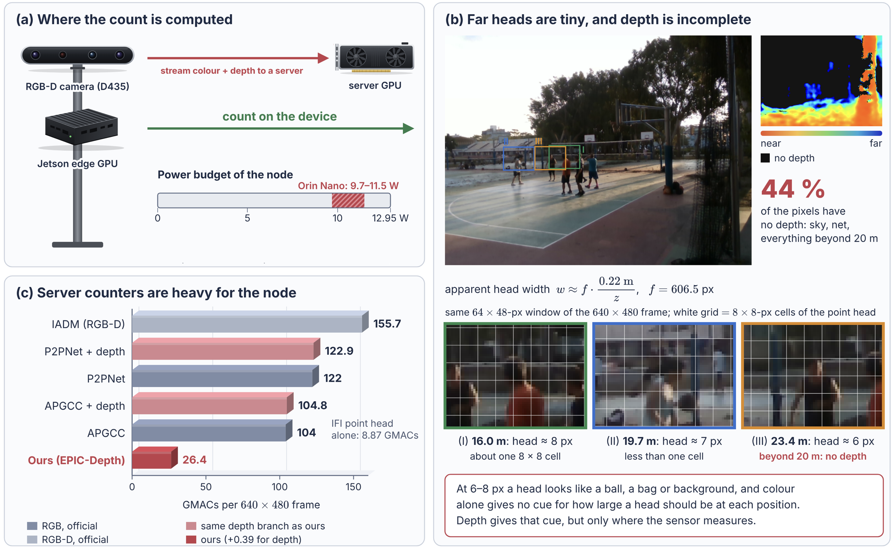
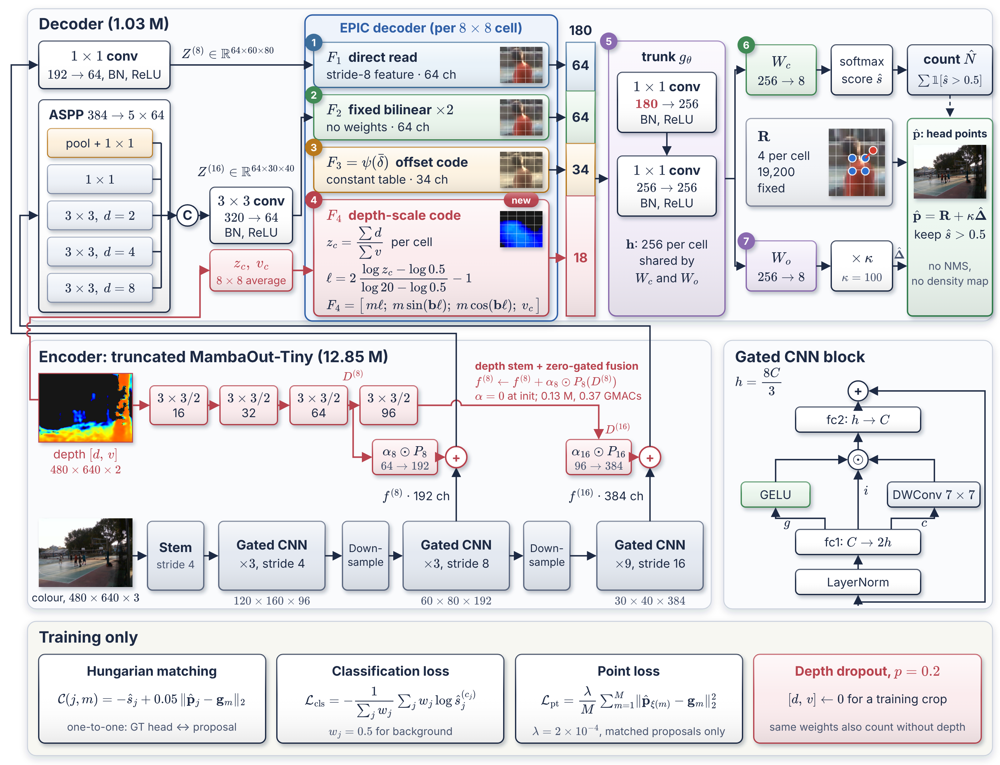
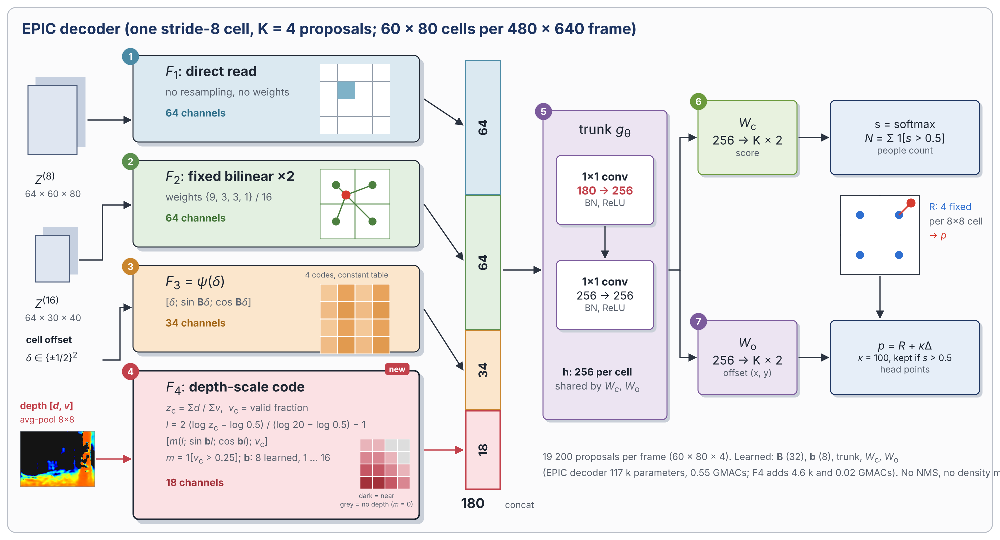
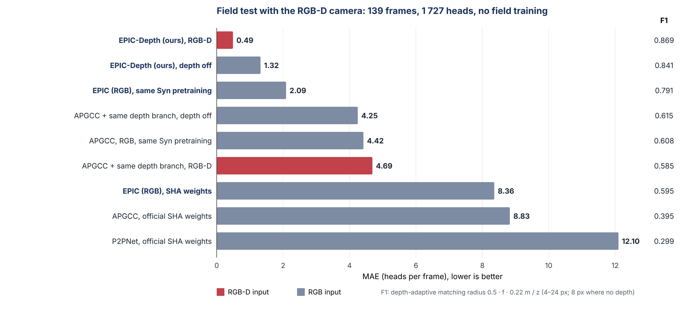
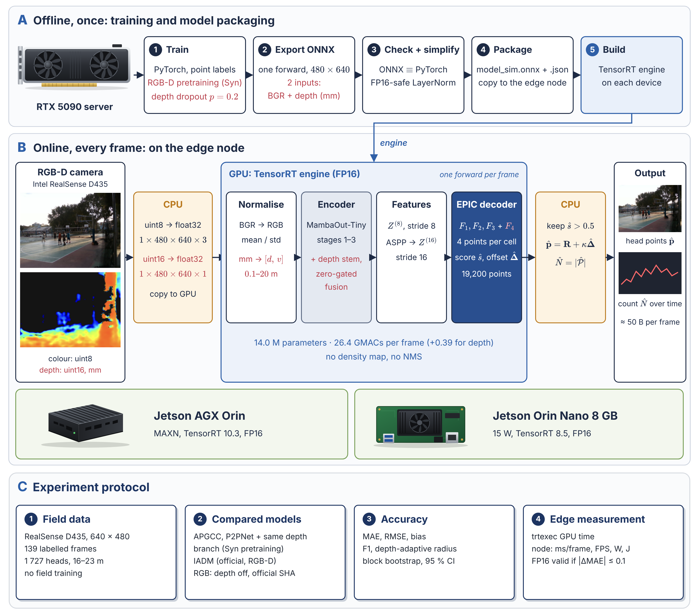

<div align="center">

# EPIC-Depth

### Efficient Point Interpolation for People Counting with RGB-D Edge Camera Sensors

**Mas Nurul Achmadiah · Chi-Chia Sun · Wen-Kai Kuo · Mao-Hsiu Hsu · Jun-Wei Hsieh**

<sub>National Formosa University · National Taiwan University of Science and Technology · National Yang Ming Chiao Tung University</sub>

[](#citation)
[](#installation)
[](#installation)
[](#deploy-on-a-jetson)
[](LICENSE)

**A point-based people counter for an RGB-D camera node. On a real RGB-D field recording (Intel RealSense D435, heads with depth at a median distance of 14.9 m), EPIC-Depth counts with MAE 0.49 (F1 0.869) at 14.0 M parameters and 26.4 GMACs per 640×480 frame, and runs at 71.4 FPS / 0.329 J per frame on a Jetson AGX Orin and 26.0 FPS / 0.372 J on a Jetson Orin Nano. Only the count and the head points leave the device.**

</div>

<p align="center"></p>

---

## Contents

[Why on the device?](#why-count-on-the-device) · [Method](#method) · [Results](#results) · [Installation](#installation) · [Training](#training) · [Field test](#field-test-on-your-rgb-d-recording) · [Deploy](#deploy-on-a-jetson) · [Repository map](#repository-map) · [Citation](#citation)

## Why count on the device?

Streaming colour and depth to a server costs 1.54 MB per 640×480 frame (921,600 B colour + 614,400 B 16-bit depth) and moves images of people off-site. Counting on the camera node sends about 50 bytes per frame (about 12 heads), but every frame must then fit the time, power and heat budget of a small edge GPU: a PoE port (IEEE 802.3af) delivers at most 12.95 W, and the Orin Nano module alone draws 9.7–11.5 W while counting. Far heads are the hard case: the heads with measured depth are at a median distance of 14.9 m and about 9 px wide, and heads at 16.0, 19.7 and 23.4 m are 8, 7 and 6 px wide, about one 8×8 cell of the point head.

<p align="center"></p>

Depth tells how large a head should look at each cell: `w ≈ f · 0.22 m / z` (f = 606.5 px). EPIC-Depth gives the point head this cue directly, at 1.5 % extra compute (0.39 GMACs).

## Method

<p align="center"></p>

| Part | What it does | Cost (640×480) |
|---|---|---|
| **Truncated MambaOut-Tiny** | Gated-CNN stages 1–3 (strides 4/8/16) on the colour image; stride-32 stage and classifier removed | 12.85 M · 24.3 GMACs |
| **Depth stem + zero-gated fusion** *(new)* | `[d, v]` → 4 × (3×3 conv /2, BN, ReLU), 16-32-64-96 ch; `f⁽⁸⁾ += α₈·P₈(D⁽⁸⁾)`, `f⁽¹⁶⁾ += α₁₆·P₁₆(D⁽¹⁶⁾)`, α = 0 at start | 0.129 M · 0.37 GMACs |
| **Feature projections** | Φ₈: 1×1 conv 192→64; Φ₁₆: ASPP (global pool, 1×1, 3×3 with dilation 2/4/8) + 3×3 conv 320→64 | 0.91 M · 1.11 GMACs |
| **EPIC decoder** | per 8×8 cell: F₁ direct stride-8 read, F₂ fixed bilinear ×2 of stride 16, F₃ constant offset code, **F₄ depth-scale code** *(new)* → shared 1×1 trunk 180→256→256 | 0.12 M · 0.55 GMACs (0.53 without F₄; IFI: 8.87) |
| **Depth dropout** *(training)* | `[d, v] = 0` for 20 % of the crops: the same weights count without depth | – |
| **Output** | 4 reference points per cell, count = #(score > 0.5) | no NMS, no density map |
| **Total** | | **14.00 M · 26.36 GMACs** |

**F₄ (18 dims):** per cell `z_c = 20 m · Σd/Σv` over its 64 pixels, clamped to 0.5–20 m, `l` = log-depth mapped to [−1, 1], `F₄ = [m·(l, sin bl, cos bl); v_c]` with `m = 1[v_c > 0.25]` and 8 learned frequencies `b` (initialised between 1 and 16). Cells without depth fall back to the RGB features (`m = 0`). F₄ adds 4.6 k weights and 0.02 GMACs.

Every new part starts as an exact identity (α = 0, zero trunk columns), so training starts from the RGB model. In code, EPIC is still called **EPFI** (`DECODER: EPFI`, `EPFI+dz`; `ENCODER: mambaout_tiny+dmid`): *EPIC was named EPFI in earlier versions.*

**Deployment rewrite.** For TensorRT, the trained network is rewritten without changing its function beyond floating-point rounding: (i) Gated CNN blocks in channels-first layout with the linear layers as 1×1 convolutions, (ii) LayerNorm affine terms folded into the following linear layer, (iii) each LayerNorm evaluated on `x/2ᵏ` with `ε/4ᵏ`, so the variance stays inside the FP16 range (`k` per layer from training-frame activations, fixed at export), (iv) one 480×640 frame instead of two 512×512 tiles, (v) raw BGR and raw depth in mm enter the graph. In FP32 the encoder features differ by at most 2.7×10⁻⁶, and the counts of the original model, the rewritten model and the ONNX graph are identical on ten frames of the field recording.

<p align="center"></p>

## Results

### RGB-D field test (main result)

- **Data:** Intel RealSense D435 mounted 1.7 m above an outdoor sports court, colour and depth at 640×480 and 30 fps, depth aligned to colour by the RealSense SDK (f = 606.5 px). Of 415 recorded frame pairs, every third is labelled: 139 frames, 1,727 heads (12.4 per frame). 74 % of the heads have valid depth (0.1–20 m, median 14.9 m), 26 % lie on pixels without depth in 0.1–20 m (no reading, or a reading beyond 20 m that is removed), and 44 % of the pixels have no depth. One annotator, starting from the points of EPIC (A) as a draft. The recording is not used for training, tuning or model selection.
- **Training:** all models are trained on public data only. The RGB-D models are trained on ShanghaiTechRGBDSyn resized by 0.5 (960×540): 40 epochs, LR ×0.1 after epoch 30, depth dropout p = 0.2, EMA 0.999, seed 1229, checkpoint with the lowest mean MAE over 10 consecutive epochs on a scene-level 10 % hold-out. Initialisation: EPIC-Depth and EPIC from EPIC trained on UCF-QNRF, APGCC from its official ShanghaiTech A weights, the P2PNet-style counter from ImageNet. APGCC and P2PNet get **the same depth stem, fusion and depth dropout** as EPIC-Depth (0.163 M, 0.48 GMACs on VGG-16) and are also trained without it; F₄ is part of the EPIC decoder and is not added to them. IADM runs with its official code and RGB-D weights (ShanghaiTechRGBD).
- **Metrics:** MAE, RMSE and bias of the per-frame count. P, R and F1: one-to-one matching, radius `0.5 · f · 0.22 m / z` clipped to 4–24 px (8 px where the head has no depth); with a head width of 0.16 or 0.28 m instead of 0.22 m, the ranking of all counters is unchanged and F1 changes by at most 0.010.

<p align="center"></p>

| Model | Input | Training | Syn MAE | MAE | RMSE | Bias | P | R | F1 |
|---|---|---|---|---|---|---|---|---|---|
| **EPIC-Depth (ours)** | RGB-D | Syn | 19.19 | **0.49** | **1.11** | +0.12 | **0.865** | **0.873** | **0.869** |
| EPIC-Depth, depth off | RGB | Syn | 20.48 | 1.32 | 1.94 | +0.14 | 0.837 | 0.846 | 0.841 |
| EPIC (RGB) | RGB | Syn | 21.95 | 2.09 | 2.90 | −0.76 | 0.817 | 0.767 | 0.791 |
| APGCC + depth branch | RGB-D | Syn | 20.34 | 4.43 | 6.07 | −3.11 | 0.709 | 0.532 | 0.608 |
| APGCC + depth branch, depth off | RGB | Syn | – | 4.56 | – | – | – | – | – |
| APGCC (RGB) | RGB | Syn | **18.70** | 4.69 | 6.32 | −2.48 | 0.658 | 0.527 | 0.585 |
| P2PNet + depth branch | RGB-D | Syn | 22.60 | 6.68 | 10.09 | +5.21 | 0.473 | 0.671 | 0.555 |
| P2PNet (RGB) | RGB | Syn | 21.50 | 6.77 | 11.48 | +4.44 | 0.486 | 0.660 | 0.560 |
| P2PNet + depth branch, depth off | RGB | Syn | – | 6.92 | – | – | – | – | – |
| EPIC (A) | RGB | SHA | – | 8.35 | 11.54 | +6.94 | 0.488 | 0.761 | 0.595 |
| APGCC (official weights) | RGB | SHA | – | 8.83 | 13.62 | +6.64 | 0.326 | 0.501 | 0.395 |
| IADM (official code and weights) | RGB-D | SHTRGBD | – | 11.76 | 14.49 | −11.72 | – | – | –* |
| P2PNet (official weights) | RGB | SHA | – | 12.10 | 18.47 | +9.19 | 0.236 | 0.410 | 0.299 |

<sub>Syn: trained on ShanghaiTechRGBDSyn with the same schedule and selection; Syn MAE is measured on its test split (960×540), which is never used for selection. SHA: official or our weights trained on ShanghaiTech A (EPIC (A) selected on the hold-out split). SHTRGBD: official IADM weights. Depth off: zero depth map, same weights; F1 is not reported for the two comparators with depth off. \*Density map, no points. Block bootstrap of the per-frame difference of absolute errors (blocks of 10 labelled frames, 10,000 resamples): depth lowers the error of the same weights by 0.83 heads per frame, 95 % interval [+0.62, +1.05]. Against the other counters trained on ShanghaiTechRGBDSyn, the mean per-frame difference is 1.60 (EPIC, RGB), 3.94 (APGCC + depth branch) and 6.19 (P2PNet + depth branch) heads per frame. Full tables: `results/rgbd/`.</sub>

**Reading.** With the same weights, depth lowers the MAE of EPIC-Depth from 1.32 to 0.49, and EPIC trained the same way without depth reaches 2.09. The same depth branch without F₄ improves APGCC only from 4.69 to 4.43 and P2PNet from 6.77 to 6.68 (5.5 % and 1.3 %, against 77 % for EPIC): the gain comes from how depth reaches the point head (F₄), not from an extra input channel. On ShanghaiTechRGBDSyn, whose depth is exact at every pixel, the counters differ much less (18.70–22.60) and APGCC without depth is best, so the advantage of EPIC-Depth is specific to small heads and incomplete depth. The error grows with the number of people (MAE per frame, by annotated heads per frame):

| Model | < 10 | 10–20 | > 20 |
|---|---|---|---|
| **EPIC-Depth** | **0.20** | **0.55** | **1.04** |
| EPIC-Depth, depth off | 0.67 | 1.55 | 2.33 |
| EPIC (RGB) | 1.21 | 2.43 | 3.41 |
| APGCC + depth branch | 2.13 | 6.35 | 7.33 |
| P2PNet + depth branch | 5.39 | 8.08 | 6.93 |

### Ablation of the depth inputs

| Variant | Stem | F₄: l | F₄: v_c | Anchor | Syn MAE | Field MAE | Field F1 |
|---|---|---|---|---|---|---|---|
| **EPIC-Depth (full)** | ✓ | ✓ | ✓ | – | **19.19** | **0.49** | **0.869** |
| stem only (w/o F₄) | ✓ | – | – | – | 19.40 | 1.56 | 0.830 |
| anchor prior (RDNet-style) | ✓ | – | – | ✓ | 19.25 | 0.88 | 0.783 |
| F₄ mask only (v_c) | ✓ | – | ✓ | – | 19.55 | 1.21 | 0.840 |
| F₄ only (w/o stem) | – | ✓ | ✓ | – | 19.30 | 0.80 | 0.855 |
| shuffled depth (test only) | ✓ | ✓ | ✓ | – | – | 2.54 | 0.780 |

<sub>All trained variants: same pretraining, schedule and selection as EPIC-Depth. Anchor prior: F₄ removed, and the point offsets of each cell scaled by `clip(γ/z_c, 4, 128)` px instead of κ = 100 px. Shuffled depth: each colour frame paired at test time with the depth map of the frame half the recording away (F1 radius from the true depth).</sub>

The score threshold τ = 0.5 was not tuned on the recording; from 0.35 to 0.65 the bias moves from +2.37 to −1.75 heads per frame and is closest to zero at 0.5. A 240×320 input cuts the computation fourfold but halves the head sizes to about 4–5 px: recall falls to 0.25 and the MAE rises to 7.71.

### EPIC decoder vs. IFI (RGB, same encoder, no depth branch)

| | IFI (APGCC) | EPIC (ours) |
|---|---|---|
| Point head (GMACs) | 8.87 | **0.53** |
| Decoder (M / GMACs) | 2.77 / 9.98 | **1.02 / 1.64** |
| Full model (M / GMACs) | 15.61 / 34.31 | **13.86 / 25.97** |
| ShanghaiTech A, MAE / RMSE | 50.75 / 90.95 | **49.13 / 77.08** |
| ShanghaiTech B, MAE / RMSE | 6.16 / 9.62 | **5.90 / 8.95** |
| Field recording, MAE FP32 / FP16 (AGX Orin, colour only) | 8.00 / 36.92 | 8.25 / 8.16 |
| FP16 valid (ΔMAE₁₆) | no (+28.92) | **yes (−0.09)** |

<sub>RGB models trained on UCF-QNRF and then ShanghaiTech A or B. The ShanghaiTech values are selected on the test set, the protocol of the published baselines (APGCC: 48.8 / 76.7 and 5.6 / 8.7), evaluated on 512×512 tiles: they show that sharing one feature per cell keeps the accuracy of IFI, not that it is more accurate. The field rows are TensorRT engines on the RGB-D recording without depth.</sub>

### Edge efficiency (RGB-D engines)

One 480×640 forward per frame, raw BGR + raw depth (mm) in, normalisation on the GPU, TensorRT engines built with `trtexec`. One node program, identical for all models, reads the frames and depth maps of the recording from disk and plays the 139 labelled frames repeatedly for one minute after ten warm-up frames; `ms/frame` is the mean end-to-end time (conversion of colour and depth, transfer, inference, thresholding). Power is the mean module power from `tegrastats` every 500 ms (AGX: sum of the module rails; Nano: `VDD_IN`), idle power not subtracted; J/frame = mean power × mean frame time. An FP16 engine is accepted if its MAE differs from that of its FP32 engine by at most 20 % of the FP32 MAE; otherwise the FP32 engine (no TF32) is reported. Clocks fixed by `jetson_clocks`.

**Jetson AGX Orin** (MAXN, JetPack 6.1, TensorRT 10.3)

| Model | Params | GMACs | Prec. | ΔMAE₁₆ | ms/frame | FPS | W | J/frame |
|---|---|---|---|---|---|---|---|---|
| **EPIC-Depth** | **14.00 M** | **26.4** | FP16 | +0.04 | **14.0** | **71.4** | **23.5** | **0.329** |
| P2PNet + depth branch | 18.90 M | 122.9 | FP16 | +0.03 | 14.3 | 69.9 | 25.8 | 0.369 |
| APGCC + depth branch | 17.91 M | 104.8 | FP32† | +3.41 | 50.5 | 19.8 | 42.9 | 2.167 |
| IADM | 18.13 M | 155.7 | FP16 | −0.02 | 29.9 | 33.4 | 32.0 | 0.956 |

**Jetson Orin Nano 8 GB** (15 W, JetPack 5.1.1, TensorRT 8.5)

| Model | Prec. | ΔMAE₁₆ | ms/frame | FPS | W | J/frame |
|---|---|---|---|---|---|---|
| **EPIC-Depth** | FP16 | +0.05 | **38.4** | **26.0** | 9.70 | **0.372** |
| P2PNet + depth branch | FP16 | +0.05 | 39.7 | 25.2 | 9.70 | 0.385 |
| APGCC + depth branch | FP32† | +3.43 | 193.3 | 5.2 | 11.47 | 2.218 |
| IADM | – | – | engine build fails (TensorRT 8.5) | | | |

<sub>ΔMAE₁₆: FP16 minus FP32 MAE of the same model on the 139 labelled frames. †FP16 engine rejected (|ΔMAE₁₆| above 20 % of the FP32 MAE), also with the depth input set to zero. Power is compared only within a device. With a zero depth map, the same EPIC-Depth engine needs 14.3 ms, 23.0 W and 0.329 J per frame on the AGX Orin and 0.372 J on the Orin Nano. `deploy/rgbd_table5.py` builds both tables and the accuracy-vs-energy figure from the run folders.</sub>

Accuracy versus energy on both devices (Fig. 5 of the paper): [`fig_acc_eff.pdf`](fig_acc_eff.pdf).

<details>
<summary><b>MAE of every engine on the 139 labelled frames</b></summary>

| Engine | PyTorch | AGX FP32 | AGX FP16 | Nano FP32 | Nano FP16 |
|---|---|---|---|---|---|
| EPIC-Depth | 0.489 | 0.489 | 0.532 | 0.489 | 0.540 |
| EPIC-Depth, depth off | 1.317 | – | 1.331 | – | – |
| P2PNet + depth branch | 6.676 | 6.705 | 6.734 | 6.705 | 6.755 |
| APGCC + depth branch | 4.431 | 4.431 | 7.842† | 4.431 | 7.863† |
| APGCC + depth branch, depth off | 4.56 | – | 7.540† | – | – |
| IADM | 11.761 | 11.763 | 11.742 | build fails | build fails |

<sub>†Invalid FP16 engine. The FP32 engines reproduce the PyTorch MAE except for P2PNet + depth branch: ONNX Runtime in FP32 on the server also gives 6.705; the PyTorch value differs by a few scores near the threshold.</sub>
</details>

### Without depth (RGB camera, earlier field videos V1–V4)

The RGB results of EPIC (ShanghaiTech weights, 84 labelled frames from four videos) are kept in `results/rgb/` and `assets/charts/`. On these videos depth is not available, so EPIC-Depth runs in its depth-off mode. These videos are not part of the paper.

<details>
<summary><b>RGB results: accuracy vs. energy on both Jetsons</b></summary>

<picture>
  <source media="(prefers-color-scheme: dark)" srcset="assets/charts/accuracy_vs_energy_dark.png">
  
</picture>

<picture>
  <source media="(prefers-color-scheme: dark)" srcset="assets/charts/field_accuracy_dark.png">
  
</picture>

Charts are generated from `results/rgb/paper_results.json` by `python tools/make_readme_figures.py`.
</details>

## Installation

EPIC-Depth is a set of **runtime plug-ins for the official [APGCC](https://github.com/AaronCIH/APGCC) code**: no APGCC file is edited.

```bash
git clone https://github.com/AaronCIH/APGCC.git
git clone https://github.com/Masnurul17/EPIC-Depth.git
conda create -n epic python=3.10 -y && conda activate epic
pip install -r EPIC-Depth/requirements.txt          # + torch matching your CUDA

cd APGCC/apgcc
cp ../../EPIC-Depth/{epic,epic_depth,data_tools}/*.py .
cp ../../EPIC-Depth/deploy/*.py ../../EPIC-Depth/scripts/*.sh .
cp -r ../../EPIC-Depth/baselines .
cp ../../EPIC-Depth/configs/*.yml configs/
python apgcc_fix_train.py                           # one-time: the public APGCC release is inference-only
python smoke_test_rgbd.py -c configs/SHHB_motiny_epfi_c512_t512_ho20_ema.yml   # identity at start, depth dropout, export wrapper
python check_vgg_rgbd.py -c configs/SHHA_apg_B_0929.yml --weights weights/SHHA_best.pth   # same checks, APGCC / P2PNet depth branch
```

`epfid_deploy.py` imports `mambaout_nchw.py` (the NCHW rewrite of the MambaOut encoder used for the RGB engines); place it in the same folder.

## Training

```bash
# 1) ShanghaiTechRGBDSyn -> point lists + 16-bit depth PNGs (mm) + scene-level hold-out
python prep_shtrgbd_syn.py --src datasets/ShanghaiTechRGBDSyn --out datasets/PointDataRGBDSyn_s050 --scan
python prep_shtrgbd_syn.py --src datasets/ShanghaiTechRGBDSyn --out datasets/PointDataRGBDSyn_s050 --scale 0.5 --workers 8

# 2) the runs of the paper (same data, schedule and selection for every model)
SYN="OUT=datasets/PointDataRGBDSyn_s050 HO=ho10 TAG=SYN40 DSNAME=SHTRGBDSYN EPOCHS=40 LR_DROP=30"
env $SYN bash run_rgbd_B_1024.sh cfg
env $SYN bash run_rgbd_B_1024.sh train full     # EPIC-Depth
env $SYN bash run_rgbd_B_1024.sh train rgb      # EPIC (RGB), the depth comparison
env $SYN bash run_rgbd_B_1024.sh train apgcc    # APGCC (RGB)
env $SYN bash run_rgbd_B_1024.sh train apgccd   # APGCC + the same depth branch
env $SYN bash run_rgbd_B_1024.sh train p2pd     # P2PNet-style head + the same depth branch
env $SYN bash run_rgbd_B_1024.sh profile        # params / GMACs per part
```

Settings (both stages in Table S-III of the paper): 512×512 random crops, scale 0.7–1.0, horizontal flip, batch 8, Adam with LR 10⁻⁴ (10⁻⁵ for the encoder; the new depth layers use the decoder rate), weight decay 10⁻⁴, EMA 0.999, seed 1229 (deterministic: the same seed and data give identical checkpoints). EPIC-Depth and EPIC (RGB) start from the UCF-QNRF EPIC weights (`INIT=` in the runbook); APGCC and APGCC + depth start from the official APGCC ShanghaiTech A weights; the P2PNet-style counter starts from ImageNet weights. Watch the log for `depth dropped in x/y crops` (about 20 %) and the EMA window MAE used for selection. The Syn test split is used only for the Syn MAE column, never for selection.

## Field test on your RGB-D recording

```bash
# colour + depth aligned to colour (ShanghaiTechRGBD style: IMG_xxxx.png + DEPTH_xxxx.mat in mm, -999 invalid)
python prep_realsense_mat.py --img-dir rec/train_img --depth-dir rec/train_depth --out field_pairs/rs_test --name rs_test
python field_annotate.py label --dir field_pairs/rs_test_gt/frames   # click heads -> <stem>.txt next to each frame

# all models side by side (models_example.json: EPIC-Depth, depth off, comparators, IADM, ONNX graphs)
python rgbd_video_test.py --source field_pairs/rs_test_gt --models models_rgbd.json --out runs/rs_test --save-points
python vis_pred_gt.py --frames field_pairs/rs_test_gt/frames --depth field_pairs/rs_test_gt/depth \
    --pred "EPIC-Depth=runs/rs_test/points/EPFI-Count-D_(ours)" "RGB=runs/rs_test/points/EPFI-Count_(RGB)" \
    --fx 606.5 --out runs/rs_test/compare
python rs_block_bootstrap.py runs/rs_test/per_frame.csv --ref "EPFI-Count-D (ours)" --block 10 --n 10000
python make_fig_assets.py --frames field_pairs/rs_test_gt/frames --depth field_pairs/rs_test_gt/depth \
    --pred "EPIC-Depth=runs/rs_test/points/EPFI-Count-D_(ours)" --out runs/rs_test/figs   # TP / FP / FN 
```

`rgbd_video_test.py` also reads RealSense `.bag`, ZED `.svo2`, and colour video + 16-bit depth.

## Deploy on a Jetson

<p align="center"></p>

```bash
# server: one 480x640 graph, raw BGR + raw depth (mm) in, opset 16, checked against PyTorch on real frames
env $SYN bash run_rgbd_B_1024.sh export full      # EPIC-Depth: NCHW rewrite + FP16-safe LayerNorm (epfid_deploy.py)
env $SYN bash run_rgbd_B_1024.sh export apgccd    # VGG comparators: no rewrite
python baselines/rgbd_baselines.py export --method iadm --repo ext/RGBTCrowdCounting \
    --ckpt ext/ckpt/iadm_rgbd_best.pth.tar --hw 480 640 --raw --opset 16 --out deploy/iadm_rgbd_480x640.onnx

# Jetson (folder with rgbd_node.py, rgbd_depth_utils.py, field_node_v*.py, rgbd_deploy/, rs_test_gt/)
sudo nvpmodel -m 0 && sudo jetson_clocks          # AGX Orin MAXN; Orin Nano: the 15 W mode
bash run_jetson_rgbd.sh agx                       # FP16 + FP32 engines, trtexec, 1-min node runs, depth off
python rgbd_table5.py --runs runs_jetson/* --trt-dir rgbd_deploy --out runs_jetson/table5   # table + accuracy-vs-energy figure
```

`rgbd_node.py` runs point counters and density counters (IADM) with the same power monitor and TensorRT runner as the RGB node (`field_node_v7.py` or later). It needs only NumPy, OpenCV and the JetPack `tensorrt` module. Live sources: `--source realsense` (depth computed on the camera) and `--source zed` (stereo depth computed on the Jetson GPU: report that run as "camera + counter"). The numbers above read the recording from disk, so they exclude capture, depth-to-colour alignment and the power of the camera.

## Pretrained weights

| Model | Training data | Field MAE (RGB-D recording) | Download |
|---|---|---|---|
| EPIC-Depth | UCF-QNRF → ShanghaiTechRGBDSyn | 0.49 | *GitHub Release (with the paper)* |
| EPIC (RGB) | UCF-QNRF → ShanghaiTech A / B | 8.35 (A, colour only) | *GitHub Release* |
| ONNX graphs, 480×640, raw inputs | – | – | *GitHub Release* |

## Repository map

```
EPIC-Depth/
├── epic/            RGB model + training plug-ins for APGCC (EPIC decoder = apgcc_epfi.py, MambaOut encoder)
├── epic_depth/      ★ RGB-D: depth stem, zero-gated fusion, F4, depth dropout (apgcc_rgbd.py),
│                    training launcher, one-time test with ledger, profiling, field test, matching, bootstrap
├── data_tools/      ShanghaiTech / QNRF / ShanghaiTechRGBD(Syn) conversion, RGB-D camera recordings, annotation
├── deploy/          ONNX export (RGB, RGB-D), NCHW deploy hook, TensorRT tools, Jetson node programs, Table V builder
├── baselines/       IADM / CSCA with their official code: evaluation, cost, raw-input ONNX
├── scripts/         the runbooks behind the paper's tables
├── configs/         yml configs (APGCC format); RGB-D ymls are written by run_rgbd_B_1024.sh cfg
├── tools/           block bootstrap, K-cell statistics, README charts
├── results/rgbd/    RGB-D field results, bootstrap, params / GMACs, Jetson runs
├── results/rgb/     RGB results (field videos V1–V4, ShanghaiTech ledger)
├── assets/          README charts of the RGB videos
└── *.png, *.pdf     figures of the paper, same file names as in the article
```

## Limitations

- One outdoor RGB-D recording (one scene, one camera) with one annotator; labelled frames are 3 frames apart, so a block bootstrap is used.
- The heads with depth are at a median distance of 14.9 m, beyond the nominal range of the D435 (about 10 m): 26 % of the heads and 44 % of the pixels have no depth in 0.1–20 m and fall back to the RGB features.
- The advantage does not carry over in full to synthetic scenes with complete depth (ShanghaiTechRGBDSyn test split).
- Energy is counter-only (frames and depth read from disk); the depth camera's own power is not included.
- Lightweight CNN encoders (e.g. MobileNet, ResNet-18) were not compared; on TensorRT 8.5 (Orin Nano) the MambaOut encoder is slower than VGG before the rewrite, because LayerNorm is not fused; see `results/rgb/`.

## Citation

```bibtex
@article{achmadiah2026epicdepth,
  title   = {EPIC-Depth: Efficient Point Interpolation for People Counting with RGB-D Edge Camera Sensors},
  author  = {Achmadiah, Mas Nurul and Sun, Chi-Chia and Kuo, Wen-Kai and Hsu, Mao-Hsiu and Hsieh, Jun-Wei},
  journal = {IEEE Sensors Journal},
  note    = {under review},
  year    = {2026}
}
```

## Acknowledgements

Built on [APGCC](https://github.com/AaronCIH/APGCC) (MIT), [P2PNet](https://github.com/TencentYoutuResearch/CrowdCounting-P2PNet), [MambaOut](https://github.com/yuweihao/MambaOut) and [timm](https://github.com/huggingface/pytorch-image-models). Data: UCF-QNRF and ShanghaiTech (RGB stage), ShanghaiTechRGBDSyn (RGB-D stage). IADM, P2PNet and APGCC were run from their official code and weights; the ShanghaiTech values of PET, Gramformer, M-SFANet and RepSFNet in the paper are quoted as published.

## License

Code: [MIT](LICENSE). Field recordings are not distributed (they show identifiable people); annotations-derived tables and per-frame results are in `results/`.
